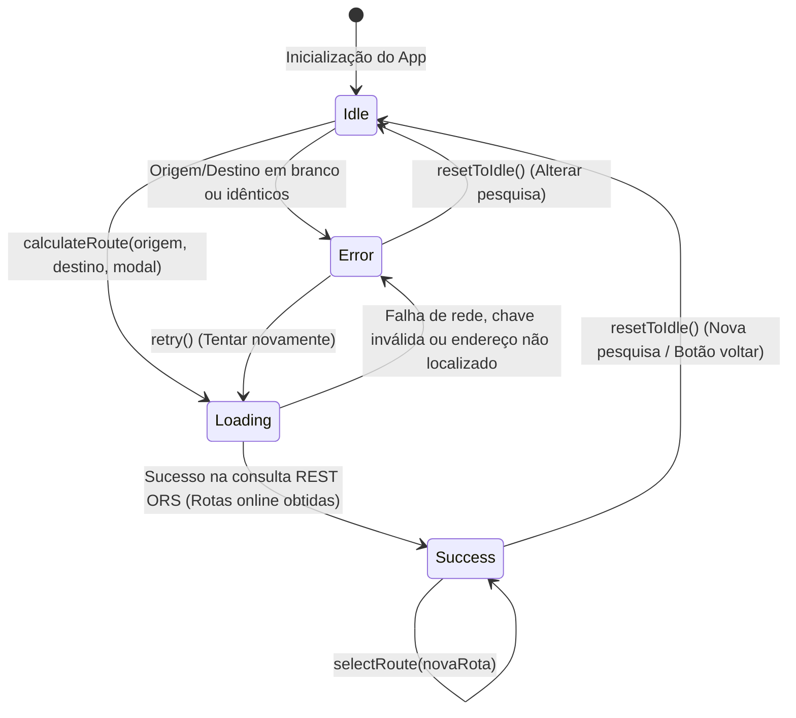

# Arquitetura do Sistema - Itinerarium

O **Itinerarium** adota o padrão arquitetural **MVVM (Model-View-ViewModel)** combinado com os princípios de **Clean Architecture** (divisão em camadas) e **Unidirectional Data Flow (UDF)** utilizando **Jetpack Compose** e **Kotlin Coroutines / Flow**.

A aplicação opera de forma **100% ONLINE**, consumindo a API REST do **OpenRouteService (ORS)** para cálculo de rotas e a API do **Nominatim (OpenStreetMap)** para geocodificação dinâmica mundial via **Retrofit 2**, e renderizando os trajetos com o **MapLibre Native Android SDK** alimentado por estilo vetorial remoto online.

---

## 🏛️ Visão Geral das Camadas

1. **Camada de Apresentação (UI & Navigation Layer)**:
   - Construída de forma 100% declarativa com **Jetpack Compose** e **Material Design 3**.
   - O `NavGraph` gerencia a navegação reativa entre as telas (`HomeScreen`, `LoadingScreen`, `ResultadoScreen` e `ErrorScreen`).
   - A `HomeScreen` renderiza em tempo real cards de sugestões de autocomplete (`originSuggestions` e `destinationSuggestions`) posicionados logo abaixo dos campos de entrada de texto.
   - A `ResultadoScreen` utiliza o componente modular `MapLibreMapView` alimentado pelo estilo **Carto Voyager (OpenStreetMap)** (`https://basemaps.cartocdn.com/rastertiles/voyager/{z}/{x}/{y}.png`), oferecendo alto detalhamento visual de ruas, avenidas e rodovias, desenho da polilinha da rota, marcadores de Origem/Destino e ajuste dinâmico da câmera (`fitBounds`), além de listar as instruções de navegabilidade nativas em português.

2. **Camada de ViewModel / Estado (ViewModel Layer)**:
   - Representada por `ItinerariumViewModel`.
   - Responsável pelo fluxo de autocomplete com **debounce de 500ms** (cancelando buscas em andamento via `Job` em corrotinas), notificando as sugestões pelos `StateFlows` `originSuggestions` e `destinationSuggestions`.
   - Mantém a retenção de coordenadas no ViewModel (`selectedOriginCoords` e `selectedDestinationCoords`) ao selecionar uma sugestão, evitando geocodificação duplicada na submissão.
   - Responsável por validar entradas do usuário (origem e destino), coordenar chamadas assíncronas ao repositório via corrotinas e emitir o estado de interface encapsulado na `sealed class UiState` (`Idle`, `Loading`, `Success`, `Error`).

3. **Camada de Repositório e Dados (Data & Network Layer)**:
   - A interface `RouteRepository` abstrai a fonte de dados para o restante da aplicação.
   - O `RepositoryProvider` injeta por padrão a classe `RemoteRouteRepositoryImpl`, que executa o fluxo remoto em 2 etapas principais:
     1. **Resolução Dinâmica de Coordenadas (`resolveCoordinates`)**: Converte endereços textuais em coordenadas geográficas `(longitude, latitude)` operando em 3 níveis resilientes:
        - Utilização direta das coordenadas salvas no ViewModel (`selectedOriginCoords` / `selectedDestinationCoords`) ou leitura de coordenadas brutas (`parseRawCoordinates`).
        - Geocodificação primária via `RouteApiService.searchGeocode` (ORS).
        - Fallback dinâmico mundial via `NominatimApiService.search` (`https://nominatim.openstreetmap.org/search`) enviando `countrycodes=br` e `accept-language=pt-BR` com o cabeçalho obrigatório `User-Agent: ItinerariumApp/1.0`, desserializando em `NominatimPlaceDto`.
     2. **Cálculo de Direções**: Consulta o endpoint `/v2/directions/{profile}` com o parâmetro `language=pt` para obter a geometria GeoJSON e instruções nativas em português trecho a trecho (*steps*).
   - Suporte a `MockRouteRepository` configurável via `RepositoryProvider.USE_MOCK = true` para testes sem rede.
   - Os modelos de domínio (`Route`, `RouteSegment`, `TransportMode`, `LatLngData`) são desacoplados dos DTOs de rede.

4. **Camada de Rede e DTOs GeoJSON / Nominatim (Network Layer)**:
   - `ApiClient`: Singleton que configura o `OkHttpClient` com `HttpLoggingInterceptor` e instancia dois clientes `Retrofit`: `routeApiService` (para ORS em `https://api.openrouteservice.org/`) e `nominatimApiService` (para Nominatim OSM em `https://nominatim.openstreetmap.org/`).
   - `RouteApiService`: Interface Retrofit com contratos para `getDirections` (com `@Query("language") language: String = "pt"`) e `searchGeocode`.
   - `NominatimApiService`: Interface Retrofit para a API do Nominatim OpenStreetMap (`search` com `@Query("q")`, `@Query("format")`, `@Query("limit")`, `@Query("countrycodes") countryCodes: String = "br"`, `@Query("accept-language") language: String = "pt-BR"` e `@Header("User-Agent") userAgent: String = "ItinerariumApp/1.0"`).
   - **DTOs GeoJSON ORS**: Classes serializáveis Gson que mapeiam as respostas de direções e geocodificação do ORS (`OrsDirectionsResponse`, `OrsFeature`, `OrsGeometry`, `OrsProperties`, `OrsSummary`, `OrsSegment`, `OrsStep`, `OrsGeocodeResponse`, `OrsGeocodeFeature`, `OrsGeocodeProperties`).
   - **DTO Nominatim (`NominatimPlaceDto`)**: Data Transfer Object para desserialização de resultados de busca do OpenStreetMap (`place_id`, `lat`, `lon`, `display_name`).

---

## 📊 Diagrama de Arquitetura em Mermaid

O diagrama abaixo ilustra o fluxo de dados e o acoplamento fraco entre os componentes do **Itinerarium**:

```mermaid
graph TD
    %% Camada de Apresentação
    subgraph UI_Layer ["Camada de Apresentação (Jetpack Compose)"]
        MA["MainActivity"] --> App["ItinerariumApp"]
        App --> NG["NavGraph (Navigation Compose)"]
        NG --> HS["HomeScreen (Formulário, Autocomplete & Modais)"]
        NG --> LS["LoadingScreen (Lottie & Feedback)"]
        NG --> RS["ResultadoScreen (Detalhes & Painel em PT)"]
        NG --> ES["ErrorScreen (Tratamento de Falhas)"]
        HS -->|Cards de Sugestão| SUG["originSuggestions / destinationSuggestions"]
        RS --> MMV["MapLibreMapView (Componente Reutilizável)"]
        MMV --> MLSDK["MapLibre SDK (Carto Voyager / OSM Raster Tile Style)"]
    end

    %% Camada de ViewModel / Apresentação de Estado
    subgraph ViewModel_Layer ["Camada de Apresentação de Estado"]
        VM["ItinerariumViewModel"]
        US["UiState (Sealed Class: Idle | Loading | Success | Error)"]
        OSFlow["StateFlow: originSuggestions"]
        DSFlow["StateFlow: destinationSuggestions"]
        COORDS["Coordenadas Retidas: selectedOriginCoords / selectedDestinationCoords"]

        VM -->|Emite StateFlow| US
        VM -->|Emite Sugestões| OSFlow
        VM -->|Emite Sugestões| DSFlow
        VM -->|Armazena Coordenadas| COORDS

        HS -->|Ação: onOriginQueryChanged (Debounce 500ms)| VM
        HS -->|Ação: onDestinationQueryChanged (Debounce 500ms)| VM
        HS -->|Ação: onOriginSuggestionSelected / onDestinationSuggestionSelected| VM
        HS -->|Ação: calculateRoute| VM
        RS -->|Ação: selectRoute / resetToIdle| VM
        ES -->|Ação: retry / resetToIdle| VM
        NG -.->|Observa reativamente| US
    end

    %% Camada de Repositório / Abstração de Dados
    subgraph Repository_Layer ["Camada de Repositório (Data Layer)"]
        RP["RepositoryProvider"]
        RR["<<interface>> RouteRepository"]
        MRR["MockRouteRepository (Dados Locais Simulados)"]
        RRR["RemoteRouteRepositoryImpl (Cliente ORS Online)"]

        VM -->|Injeção de Dependência| RR
        RP -->|Fornece instância (USE_MOCK=false)| RRR
        RP -.->|Injeta fallback se USE_MOCK=true| MRR
        RR <|.. MRR
        RR <|.. RRR
    end

    %% Camada de Rede & DTOs GeoJSON OpenRouteService e Nominatim OSM
    subgraph Network_Layer ["Camada de Rede & DTOs (ORS & Nominatim OSM)"]
        BC["BuildConfig.ORS_API_KEY"]
        AC["ApiClient (OkHttpClient + Retrofit + Gson)"]
        RAS["RouteApiService (HTTP GET /v2/directions [language=pt] & /geocode)"]
        NAS["NominatimApiService (HTTP GET /search [countrycodes=br & accept-language=pt-BR])"]
        DTO["DTOs GeoJSON ORS (OrsDirectionsResponse / OrsGeocodeResponse)"]
        NPDTO["NominatimPlaceDto (lat, lon, display_name)"]
        DM["Modelos de Domínio (Route, RouteSegment, LatLngData, TransportMode)"]

        VM -.->|Autocomplete em tempo real| NAS
        RRR --> BC
        RRR --> AC
        AC --> RAS
        AC --> NAS
        RAS --> DTO
        NAS --> NPDTO
        RRR -->|Converte DTOs GeoJSON e Nominatim| DM
    end
```

---

## 🔄 Fluxo de Estados (UiState) e Navegação Sincronizada

A interface do usuário é conduzida estritamente pelas variações do modelo de estado imutável `UiState`:

```kotlin
sealed class UiState {
    data object Idle : UiState()
    data object Loading : UiState()
    data class Success(
        val routes: List<Route>,
        val selectedRoute: Route,
        val origin: String,
        val destination: String
    ) : UiState()
    data class Error(
        val message: String
    ) : UiState()
}
```

### Diagrama de Transição de Estados



---

## 📦 Estrutura e Explicação dos Pacotes

O código-fonte do projeto está organizado sob o pacote raiz `com.itinerarium`:

```
com.itinerarium
├── ItinerariumApplication.kt    # Inicialização do MapLibre.getInstance(this)
├── MainActivity.kt              # Activity principal com suporte a Edge-to-Edge
├── ItinerariumApp.kt            # Composable raiz do aplicativo e tema
├── data
│   ├── model
│   │   ├── RouteModels.kt       # Modelos de domínio: Route, RouteSegment, LatLngData
│   │   └── TransportMode.kt     # Enum de modais (velocidade, custo, CO2 e perfis ORS)
│   ├── network
│   │   ├── ApiClient.kt         # Retrofit Singleton com OkHttpClient & Logging (ORS & Nominatim OSM)
│   │   ├── NominatimApiService.kt# Interface Retrofit para Nominatim (OpenStreetMap)
│   │   ├── RouteApiService.kt   # Endpoints REST OpenRouteService (Directions & Geocode)
│   │   └── dto
│   │       ├── NominatimPlaceDto.kt # DTO para respostas da busca no Nominatim OSM
│   │       ├── OrsDirectionsDto.kt # DTOs GeoJSON para respostas de rotas
│   │       └── OrsGeocodeDto.kt    # DTOs GeoJSON para busca de coordenadas por endereço
│   └── repository
│       ├── RouteRepository.kt          # Interface abstrata do repositório
│       ├── RemoteRouteRepositoryImpl.kt# Repositório remoto 100% online consumidor do ORS & Nominatim OSM
│       ├── OfflineRouteRepositoryImpl.kt# Repositório offline com fallback
│       ├── MockRouteRepository.kt      # Repositório mockado para testes
│       └── RepositoryProvider.kt       # Provedor/Fabrica de instâncias de repositório
├── ui
│   ├── components
│   │   └── MapLibreMapView.kt   # Componente Compose com MapView nativo, estilo e fitBounds
│   ├── navigation
│   │   ├── ScreenRoutes.kt      # Rotas de navegação do Compose
│   │   └── NavGraph.kt          # Grafo de navegação reativo baseado no UiState
│   ├── screens
│   │   ├── HomeScreen.kt        # Tela de formulário de busca e modais
│   │   ├── LoadingScreen.kt     # Tela de carregamento com animação Lottie
│   │   ├── ResultadoScreen.kt   # Tela de mapa MapLibre e comparação de rotas
│   │   └── ErrorScreen.kt       # Tela de tratamento de erros com recuperação
│   ├── theme
│   │   ├── Color.kt             # Cores M3 e paleta sustentável EcoGreen
│   │   ├── Theme.kt             # Suporte a Dynamic Color (Android 12+) e Temas
│   │   └── Type.kt              # Tipografia personalizada
│   └── utils
│       └── TransportModeExtensions.kt # Extensões de mapeamento visual de modais
└── viewmodel
    ├── ItinerariumViewModel.kt  # ViewModel gerenciadora de estado e corrotinas
    └── UiState.kt               # Sealed class de estados de UI
```
